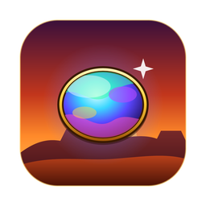
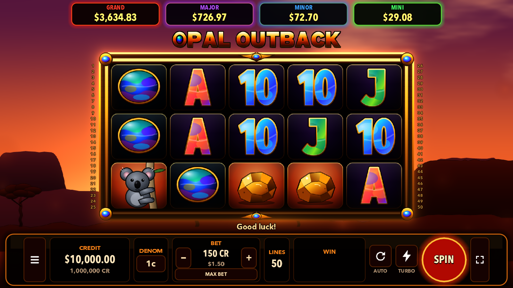
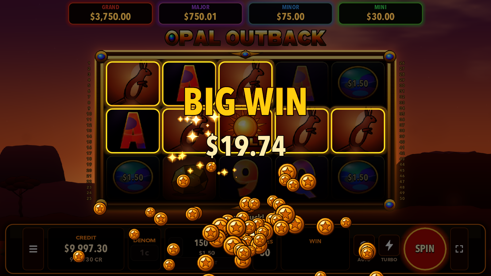
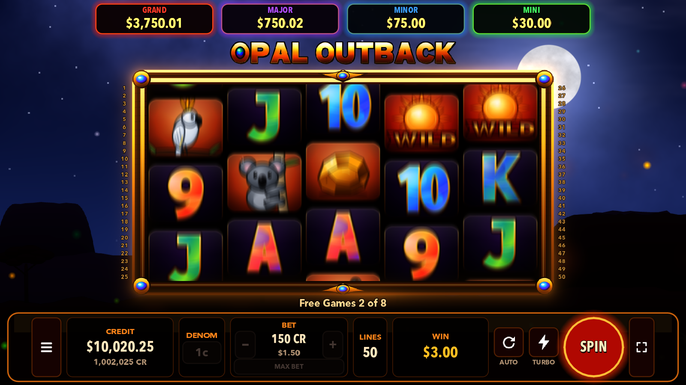
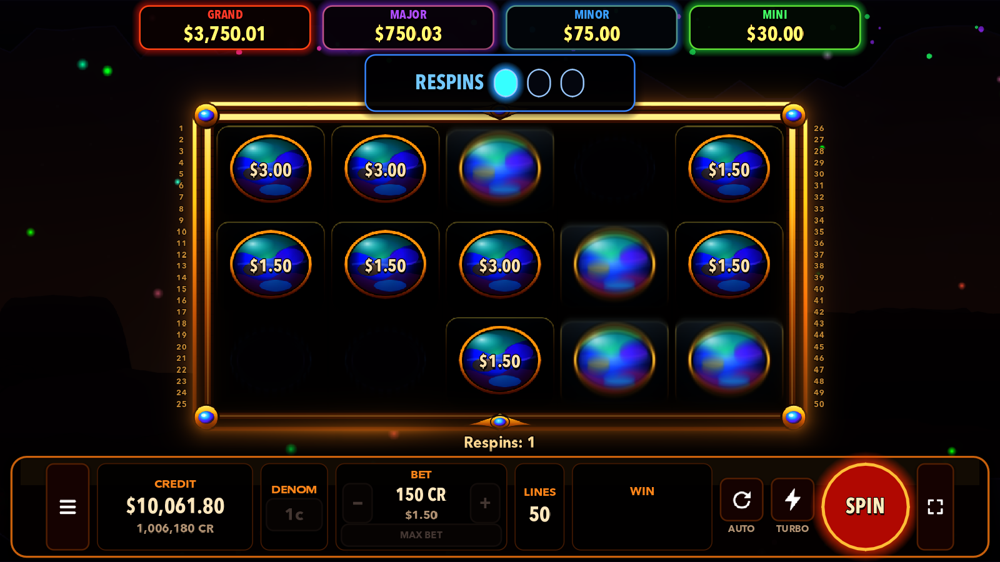

   
  

<b>Golden-hour spins in the red centre.</b> 
An original outback pokie with glowing opals, a kangaroo stampede and moonlit free games.

  
  &nbsp;
  

> **Play money only.** Credits have no cash value and can't be bought or withdrawn. There are no purchases, no ads and no links to gambling sites.

## Screenshots

| Main game | Big Win |
|---|---|
|  |  |
| **Moonlight Free Games** | **Opal Lock** |
|  |  |

## Features

- **5 reels, 50 paylines**, eight denominations from 1c to $2 and six bet levels.
- **Moonlight Free Games**: 3+ Desert Moons win 8, 12 or 20 free games under a starry sky. Every Wild carries a x2, x3 or x5 multiplier, and multipliers on a line multiply together.
- **Opal Lock**: land 6+ glowing opals to lock them in and win respins. Fill the screen for the **GRAND**.
- **Stampede**: at any moment a mob of kangaroos can bound across the reels, leaving Wilds behind.
- **Four jackpots**: MINI, MINOR, MAJOR and GRAND (play money, local to your computer).
- **Gamble** your win on a card's colour or suit, or switch the gamble off.
- Smooth, satisfying reels with slam-stop, turbo, autoplay (with a loss limit), win celebrations from Nice Win to Mega Win, and all-original art, sound and music.
- Fair by design: every result comes from a securely seeded random number generator and real reel strips, decided the moment you press Spin. Theoretical return: about 96.6%.
- Full keyboard, mouse and controller support; fullscreen with F.

## Requirements

- **Mac:** Apple Silicon (M1 or later), macOS 11 Big Sur or later.
- **Windows:** Windows 10 or 11, 64-bit, with a graphics card that supports Vulkan or Direct3D 12.

## Install

**Mac**
1. Download **OpalOutback.dmg** and open it.
2. Drag **Opal Outback** into **Applications**.
3. The first time, right-click Opal Outback in Applications and choose **Open**, then **Open** again. (The game isn't notarised by Apple, so macOS asks once.)

**Windows**
1. Download **OpalOutback-Windows.zip** and unzip it.
2. Double-click **OpalOutback.exe**.
3. If SmartScreen says "Windows protected your PC", click **More info** and then **Run anyway**.

## Updates

Opal Outback checks this page for new versions at most once a day (you can switch this off, or check any time, in **Settings → Updates**). When an update is out, the game shows what's new and a **Download update** button that fetches the latest version from here. Your balance and stats are kept.

## Privacy

Everything stays on your computer. The only thing that goes online is the optional once-a-day version check with GitHub. No accounts, no analytics, no tracking.

## Report a problem

Something not right? [Open an issue](https://github.com/MilkshakeSR/OpalOutback/issues/new) and include your version (shown on the start screen) and your Mac or Windows version.

## Version history

See [Releases](https://github.com/MilkshakeSR/OpalOutback/releases).

If gambling ever stops being fun: [gamblinghelponline.org.au](https://www.gamblinghelponline.org.au)

---
© 2026 Steven Robertson. All rights reserved.
